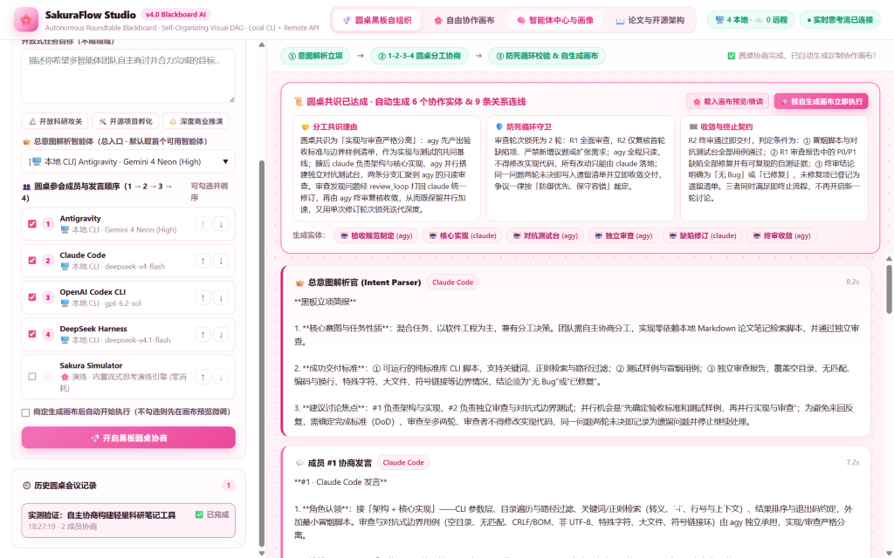
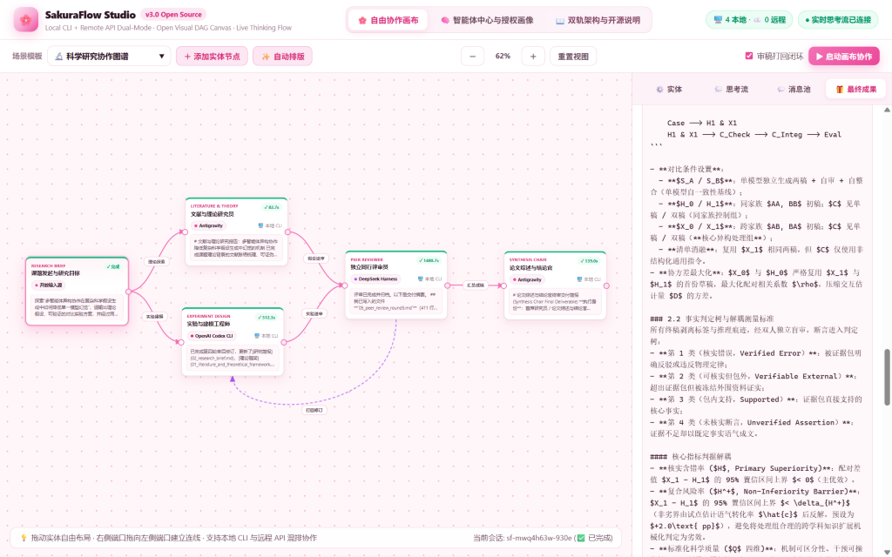
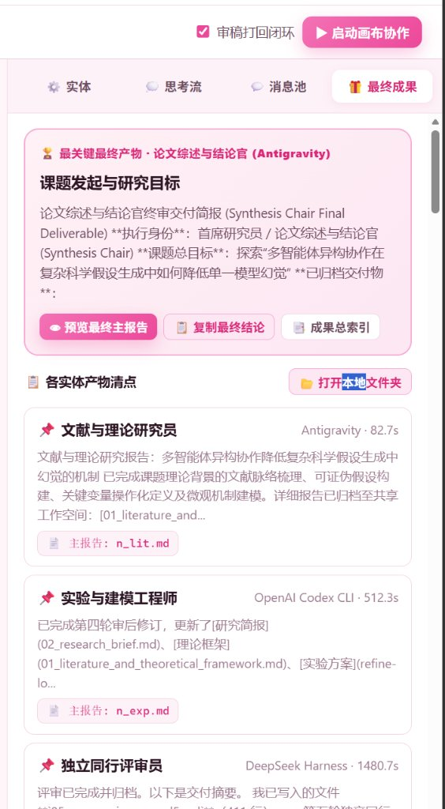
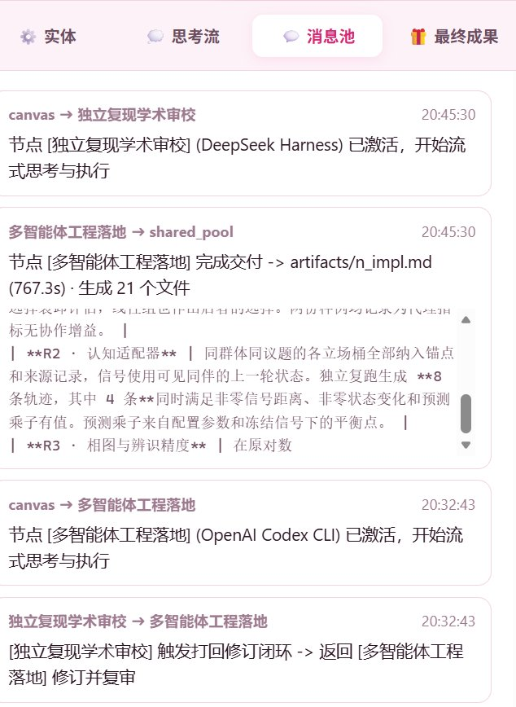

# 🌸 SakuraFlow Studio v1.0

> **别再给 AI 画死板的流程图了——让它们自己坐下来开个圆桌会，自己决定怎么分工。**  
> 一个零外部依赖的本地多智能体协同画布：把你电脑上已经装好的 **Claude Code、OpenAI Codex、Antigravity、DeepSeek Harness**（以及任意远程 API 模型和 SSH 远程 GPU 服务器）拉到同一块**共享黑板**前，像真人团队一样按 `1 → 2 → 3 → 4` 自由商量分工、自己生成协作画布、自己防死循环，最后把整理好的核心成果直接交到你手上。


---

## 💡 为什么要做这个项目？（一点真心话）

如果你平时既写代码又搞科研，你电脑里大概率同时装着好几个 AI 工具：比如用 **Antigravity (Gemini / Opus)** 做长文档规划、用 **Claude Code / Codex** 写代码跑脚本、用 **DeepSeek** 做超长推理和挑刺审稿。

但平时我们是怎么用它们的？**基本全靠“人肉复制粘贴”**——把 A 的输出复制给 B，再把 B 写的代码贴给 C 审查。

后来市面上出了很多“工作流（Workflow）”工具，但用下来总觉得不对劲：
1. **流程太死板**：每换一个新课题，都得人类自己去画一堆框和线。可真实的科研或开发团队接到任务时，难道不是**大家先围着黑板开个启动会，谁擅长什么自己认领，商量好谁跟谁并行、谁负责审稿**，然后再开干吗？
2. **到处要重新填 API Key**：明明我电脑上的客户端都已经登录好账号、配好反代和 MCP 工具了，为什么还要我再掏钱配一遍 API Key？
3. **跑完找不到重点**：几个智能体跑了一堆中间文件，最后到底哪份才是最终能用的主报告？

这就是 **SakuraFlow Studio** 想解决的事——**不做死板的流水线，而是给你电脑里的智能体们建一间高颜值的「樱花圆桌议事厅 + 自由协作画布」**。

---

## 📸 核心界面与玩法一览

### 1. 🫧 圆桌黑板自组织：把智能体当真人团队，先开会再干活

你只需要输入一个开放目标（无论是毕业设计科研攻关、孵化一个开源小工具，还是做一次商业方案推演），指定一位 **👑 总意图解析官**（默认自动选你电脑上扫到的第一个智能体），再给参会成员排好 `1 → 2 → 3 → 4` 的发言顺序：



- **① 意图解析立项**：总意图解析官先把你的需求拆解成核心目标与验收底线，贴在共享黑板上；
- **② 1-2-3-4 顺序圆桌认领**：每个智能体依次读取黑板和前面队友的发言，主动认领最契合自己模型强项的角色（比如 `#1` 认领核心实现，`#2` 看到后主动认领对抗测试与独立代码审查）；
- **③ 自己敲定「防死循环契约」并生成画布**：团队会现场商量好**最多允许打回几轮、什么条件下必须收敛交付**（配合后端的确定性 DFS 环路检测器，从根源杜绝智能体无限互相扯皮），然后**一键在画布上生成本次任务专属的协作拓扑图**！

---

### 2. 🌸 樱花自由协作画布：看得见的 Thinking 思考流与打回闭环

圆桌商量完的方案（或者你直接选用的「科学研究 / 软件工程 / 红蓝辩论」模板）会直接展现在这张樱花白粉点阵画布上：



- **长方形实体 + 贝塞尔连线**：自由拖拽布局、从右侧端口拉线到左侧端口、随时修改连线上的关系标签；
- **真·并行执行 + Thinking 实时滚动**：同一个上游分叉出去的多个智能体会**同时并发启动**，每个实体框内部都会实时滚动它此刻正在思考的推理流；
- **独立审查打回闭环（Review Loop）**：当独立审稿员或代码审查员发现漏洞输出 `VERDICT: REVISE` 时，紫粉虚线会自动触发打回返工，让上游修改后再进行二次复审。

---

### 3. 🎁 最终成果总览 & 💬 可展开的共享消息池

再也不用去文件夹里大海捞针找产物了！协作一结束，右侧会自动切到 **「🎁 最终成果」** 面板：

<p align="center">
  
  
</p>

- **🏆 最关键最终产物置顶**：一眼看到终审/汇总节点的核心结论，点一下就能弹出大视野阅读窗看全文、一键复制结论，或者直接点 **`📥 下载成果包 (.zip)`** 把所有报告、代码和圆桌会议纪要（`BLACKBOARD_ROUNDTABLE.md` + `DELIVERABLES_INDEX.md`）整包带走。
- **💬 消息池全文回溯**：每一次上下游交接都记录在共享消息池里，点击任意卡片即可原地展开或弹窗阅读完整交付内容。

---

## ⚙️ 三轨全兼容：本地 CLI + 远程 API + SSH 远程 GPU 算力

不管别人的电脑是什么环境，克隆下来都能直接跑：

| 运行轨道 | 适用场景 | 怎么工作的？ |
| :--- | :--- | :--- |
| **🖥️ 本地 CLI 模式**<br>*(零 API Key 推荐)* | 电脑上装了 `Antigravity (agy)`、`Claude Code`、`OpenAI Codex`、`DeepSeek Harness (dsh)`、`Gemini CLI`、`OpenCode`、`Aider`、`Ollama` | **不需要你把这些桌面软件全开在后台占内存，也不需要填 API Key！** 只要你以前登录过一次，SakuraFlow 会在需要某个节点干活时按需拉起它的官方无头 CLI 子进程，直接复用本机合法保存的登录态、反代和 MCP 工具，干完即退。 |
| **☁️ 远程 API 模式**<br>*(Base URL + Key)* | 电脑上没装本地 CLI，或者想接入 DeepSeek / OpenAI / OpenRouter / 硅基流动等云端模型 | 在「🧠 智能体中心」填入 `Base URL + API Key + Model ID`，原生支持流式输出与 `reasoning_content` 思考流，还能和本地 CLI 智能体在**同一张画布上自由混排**。 |
| **⚡ SSH 远程 GPU 模式**<br>*(远程服务器算力)* | 需要调用实验室 A100/4090 服务器或云端 Linux 主机跑深度学习实验、搭环境 | 在「🧠 智能体中心」填入 SSH 主机与私钥路径，支持一键探测远端 `nvidia-smi` 显卡状态与 Python/Conda 环境，可直接作为画布算力节点或供智能体远程调度。 |

> **🔐 授权动态画像（拒绝硬编码）**：系统不会臆造任何智能体的能力。点击「授权自检并生成画像」后，系统才会向你的智能体发一条轻量自检指令，实测响应延迟并动态绘出 6 维能力条与最擅长的领域。

---

## 🚀 30 秒极速启动（真·零外部依赖）

整个项目完全使用 **Node.js 原生内置模块** 编写，**不需要 `npm install`**，永远不会遇到装包报错：

```bash
git clone https://github.com/YUshire/SakuraFlow-Studio.git
cd SakuraFlow-Studio
npm start
```

- **Windows 用户**更简单：直接双击目录下的 **`启动SakuraFlow.bat`**，浏览器会自动打开 **`http://127.0.0.1:3888`**。
- **内置一系列防崩溃细节**：220ms 流式防卡死节流、30 分钟活跃心跳看门狗（长考不误杀）、Windows 完整进程树清理、服务重启中断自动识别、**一键断点续跑（跳过已完成节点）**，以及 DSH 遇到 429 额度限流时自动切换备用模型从 `--session-id` 原地续接。

---

## 📚 站在这些优秀论文与开源项目的肩膀上

SakuraFlow Studio 的设计参考并融合了近年多智能体领域的代表性工作：
- **LbMAS (2025) & NeurIPS 2025 Blackboard MAS**：共享黑板架构与智能体自主认领机制；
- **AutoAgents (IJCAI 2024) / DyLAN (COLM 2024) / AFlow (ICLR 2025)**：面向特定任务的动态团队组建与工作流自生成；
- **MetaGPT (ICLR 2024 Oral) & ChatDev (ACL 2024)**：SOP 工件标准化、共享消息池与独立审查去幻觉打回闭环；
- **Paperclip AI / Vibe Kanban**：异构本地 CLI 统一纳管与隔离共享工作空间（`workspaces/<run-id>/shared_workspace`）。

---

## 🔒 隐私说明 & License

- 你在本地配置的任何 API Key、SSH 主机信息、桥接补丁与运行产物均保存在本地 `data/` 与 `workspaces/` 目录中（已严格写入 `.gitignore`），绝不会上传或外泄。
- 本项目基于 [MIT License](./LICENSE) 开源。如果它帮到了你的科研或开发工作，欢迎点一颗 **Star ⭐**！
